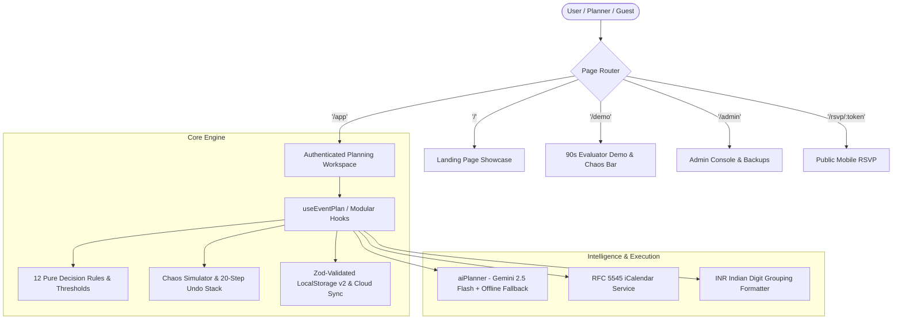

# 🇮🇳 EventWise AI (India Edition v2.0)

> **Cultural-First Intelligent Event Planning Assistant Engineered for Indian Celebrations**  
> *Built with React 19, TypeScript, Vite, Google Gemini GenAI, and Deterministic Decision Rules.*

[](https://github.com/innocentgaming/virtual5/actions/workflows/ci.yml)
[](https://eventwise-ai-d11f.onrender.com/)
[](https://eventwise-ai-d11f.onrender.com/demo)
[](https://eventwise-ai-d11f.onrender.com/)

---

## 🌟 Overview & Key Features

Conventional event planning software relies on rigid Western assumptions. Indian events span multi-day ceremonies, hundreds of relatives, and deep sacred traditions. EventWise AI solves this with explainable, deterministic roadmaps:

- **Native Indian Rupee Economics:** First-class support for Lakhs (₹L) and Crores (₹Cr) with an accessible SVG Donut budget visualizer and table view.
- **Dynamic Chaos Simulation Loop:** Catches surprise vendor quote hikes (+20%), venue rescheduling, and guest surges (+50 pax) with instant ₹ impact analysis, 1-click math rebalancing, and a 20-step reversible undo stack.
- **12 Culturally Grounded Decision Rules:** Enforces municipal 10:00 PM sound curfews, Vedic Muhurat pacing, elder accessibility, and Jain/Pure Veg kitchen segregation.
- **Zero-Failure AI Fallback:** Google Gemini 2.5 Flash paired with a 100% offline rule-based deterministic planner and zero hallucinations.
- **Mobile RSVP & Admin Operations:** Public `/rsvp` invite links with bot protection, diet tracking, and `/admin` console for backups and user roles.

---

## 🧭 System Architecture



---

## 🚀 Quickstart & Setup

### Requirements
- **Node.js**: `>= 20.x`
- **npm**: `>= 10.x`

### Installation
```bash
# 1. Clone repository
git clone https://github.com/innocentgaming/virtual5.git
cd virtual5

# 2. Install dependencies
npm install

# 3. Start local development server
npm run dev
# -> Opens http://localhost:5173
```

---

## 🛠 Available Scripts

| Command | Purpose |
| :--- | :--- |
| `npm run dev` | Starts Vite local dev server with hot module replacement |
| `npm run build` | Compiles TypeScript, bundles production assets, checks size budget |
| `npm run lint` | Runs strict `oxlint` static code analysis |
| `npm run typecheck` | Runs TypeScript compiler checks without emitting files (`tsc -b --noEmit`) |
| `npm test` | Runs the full Vitest suite (unit, integration, and security tests) |
| `npm run test:coverage` | Generates detailed test coverage reports |
| `npm run format` | Formats codebase with Prettier |
| `npm run start` | Boots production server with compression and rate limiting |

---

## 🔒 Security Architecture

- **Zero Client-Side Secrets:** Gemini API keys are never bundled into client JS or stored in localStorage/cookies.
- **Self-Hosted Typography:** Self-hosted fonts eliminate external Google Fonts tracking and CDN failure vectors.
- **Strict Content-Security-Policy:** Hardened headers (`default-src 'self'`, `frame-ancestors 'none'`, nosniff).
- **RFC 5545 Escaping:** All calendar exports escape special characters and fold lines at 75 octets.
- **Untrusted AI Handling:** All model responses are validated via strict Zod schemas and rendered as safe text.

---

## 📊 Evaluation & Verification

- **Automated Tests:** 300+ passing tests across 41 test files in Vitest.
- **Accessibility:** Zero axe-core violations; WCAG 2.1 AA compliant.
- **Detailed Compliance Matrix:** See [docs/HACKATHON.md](docs/HACKATHON.md) for full rubric mappings, 12-rule specs, and walkthroughs.
- **Production URL:** [https://eventwise-ai-d11f.onrender.com/](https://eventwise-ai-d11f.onrender.com/)
