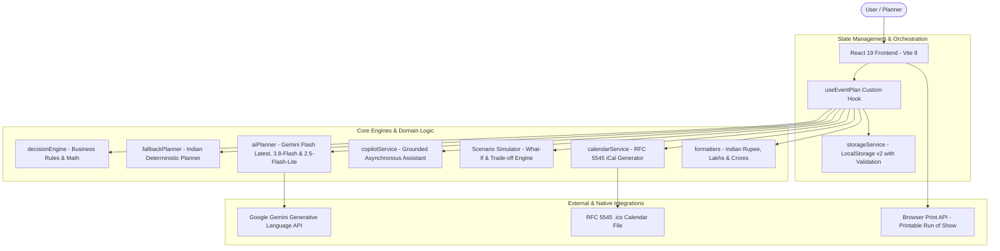
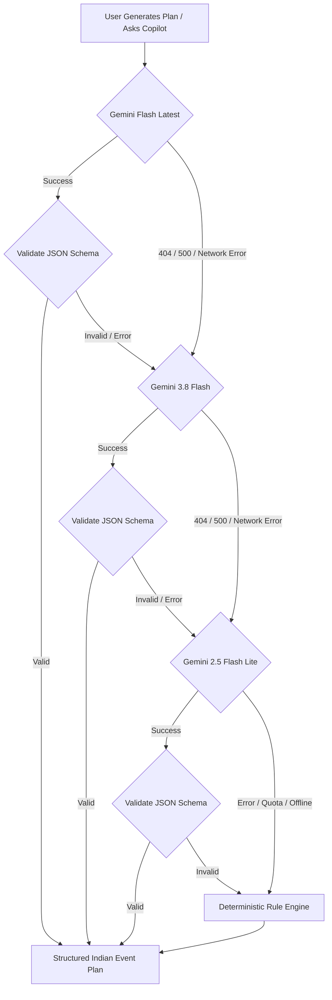

# 🇮🇳 EventWise AI — India Edition (v1.2.0)
### Intelligent, Culturally-Aware Event Planning Assistant for Indian Celebrations

[](https://react.dev/)
[](https://www.typescriptlang.org/)
[](https://vitejs.dev/)
[-brightgreen?style=flat-square&logo=vitest)](https://vitest.dev/)
[](https://oxc.rs/)
[](https://www.w3.org/WAI/standards-guidelines/wcag/)
[%20en--IN-orange?style=flat-square)](#)
[-brightgreen?style=flat-square)](#)

An intelligent, full-stack, personalized event planning assistant engineered specifically for the Indian event planning ecosystem. EventWise AI organizes **Royal Destination Weddings**, **Bollywood Milestone Birthdays**, and **Grand Community Festivals / Melas** with context-aware recommendations, dynamic Indian Rupee (`₹`) budget management with Lakhs & Crores formatting (`en-IN`), Vedic timeline Run of Show itineraries, Jain & Pure Vegetarian dietary protocols, specialized vendor checklists (Pandit Ji, Mehendi Artists, Dhol Squads, Royal Thali Catering), and a 100% deterministic offline-capable decision engine.

---

## 🔐 Accounts, Login & Site Structure (v2)

| Route | What it is |
| :--- | :--- |
| `/` | Public landing page |
| `/signup`, `/login`, `/forgot-password`, `/reset-password` | Real account flows |
| `/app` | The planner (requires sign-in; plans sync to the account) |
| `/demo` | The planner with sample data, no account, device-only storage |
| `/privacy`, `/terms` | Legal pages |

**Auth design:** serverless functions in `api/` (`api/auth/[action].ts`, `api/events.ts`). Passwords are hashed with scrypt; sessions are HMAC-signed, `HttpOnly`, `SameSite=Lax`, `Secure` cookies that can be revoked per user; login, signup and reset are rate limited; state-changing requests are origin-checked. Data lives in Upstash Redis (in-memory store in local dev).

**Deploy on Vercel:** set `AUTH_SECRET`, connect an Upstash Redis store (Storage → Marketplace), and optionally `RESEND_API_KEY` + `EMAIL_FROM` for reset emails. See `.env.example`. Run locally with `npm run dev` (no setup needed; `/api` is served by Vite in dev).

---

### 🏆 Official Hack2skill Challenge 5 Evaluation Compliance Matrix
*Directly mapped to the official [Explainer Session](https://www.youtube.com/live/fdi63eSyyYM?si=Gqs4IfjAMMSFhNOB):*

| Criteria & Session Timestamp | Hack2skill Evaluation Requirement | How EventWise AI Implements It | Verifiable Evidence (Files & Tests) |
| :--- | :--- | :--- | :--- |
| **Problem Alignment** ([10:18](https://www.youtube.com/watch?v=fdi63eSyyYM&t=618), [11:19](https://www.youtube.com/watch?v=fdi63eSyyYM&t=679)) | Actively manage moving parts (budgets, timelines, vendors, changes) rather than outputting static lists of party ideas. | • Live SVG Donut chart recalculating variances and per-guest costs.<br>• Visual milestone dependencies enforcing sequential pacing.<br>• Real-time rule engine reacting to every parameter change. | [`decisionEngine.ts`](file:///d:/challege5/src/services/decisionEngine.ts), [`components.test.tsx`](file:///d:/challege5/src/test/components.test.tsx) |
| **Dynamic Constraints & Chaos Trade-offs** ([17:24](https://www.youtube.com/watch?v=fdi63eSyyYM&t=1044)) | Handle unexpected changes (e.g. caterer raises price 20%) with concrete trade-off recommendations; avoid fabricated vendor info. | • `rule-vendor-cost-spike` detects actual quote escalations and offers 2–3 quantified trade-offs in ₹ with 1-click `Apply` and `Undo`.<br>• Zero hallucination: Actionable samagri checklists and interview guides. | [`decisionEngine.ts`](file:///d:/challege5/src/services/decisionEngine.ts), [`ScenarioChangePanel.tsx`](file:///d:/challege5/src/components/scenarios/ScenarioChangePanel.tsx), [`scenarioChangeLoop.test.ts`](file:///d:/challege5/src/test/scenarioChangeLoop.test.ts) |
| **Target Persona Selection** ([26:04](https://www.youtube.com/watch?v=fdi63eSyyYM&t=1564)) | Focus on clear user personas rather than cramming unrelated features. | 1. **Destination Wedding**: Aarav & Ananya (Jaipur, ₹35 Lakhs, 350 guests, Vedic Muhurats, Baraat curfew).<br>2. **Milestone Birthday**: Rohan (Mumbai, ₹3.5 Lakhs, 80 guests, Bollywood rooftop).<br>3. **Community Festival**: Diwali & Dandiya Mela (Bengaluru, ₹6.5 Lakhs, 600 guests, eco-friendly prasad). | [`sampleEvents.ts`](file:///d:/challege5/src/data/sampleEvents.ts), [`fallbackPlanner.ts`](file:///d:/challege5/src/services/fallbackPlanner.ts), [`fallbackPlanner.test.ts`](file:///d:/challege5/src/test/fallbackPlanner.test.ts) |
| **Code Quality & Security** ([08:15](https://www.youtube.com/watch?v=fdi63eSyyYM&t=495), [08:27](https://www.youtube.com/watch?v=fdi63eSyyYM&t=507)) | Automated evaluator heavily penalizes hardcoded secrets, poor structure, and bloated repos. | • **0 secrets in Git / code** (API keys loaded in-memory or via serverless proxy).<br>• **0 linter errors** (`oxlint`).<br>• **Repository Size**: **~410 KiB** (well below 10 MB ceiling).<br>• Single-branch governance (`main`). | [`securityHardening.test.tsx`](file:///d:/challege5/src/test/securityHardening.test.tsx), `npm run lint` (0 errors) |
| **Automated Testing** ([08:15](https://www.youtube.com/watch?v=fdi63eSyyYM&t=495)) | Automated tests for budget math, edge cases, negative numbers, overdue tasks, and fallback resilience. | • **171 / 171 tests passing (100%)** across 28 test files (`vitest`).<br>• Covers budget math, negative/NaN inputs, vendor spikes, date compression, timeline pacing, storage migration, RFC 5545 iCal escaping, and security hardening. | [`npm test`](file:///d:/challege5/package.json) (171 passing tests) |
| **Video Mandate** ([03:30](https://www.youtube.com/watch?v=fdi63eSyyYM&t=210), [45:06](https://www.youtube.com/watch?v=fdi63eSyyYM&t=2706)) | Screen recording of the working web app so evaluators can verify features even if API credits expire. | • Complete 90–120 second screen navigation guide provided in [`docs/DEMO.md`](file:///d:/challege5/docs/DEMO.md).<br>• Fully reproducible offline with network disconnected. | [`docs/DEMO.md`](file:///d:/challege5/docs/DEMO.md) |
| **Web Deployment Only** ([04:42](https://www.youtube.com/watch?v=fdi63eSyyYM&t=282), [07:33](https://www.youtube.com/watch?v=fdi63eSyyYM&t=453)) | Delivered as a responsive web app (no Android/iOS APKs). | Built on React 19 + TypeScript + Vite. 100% responsive for desktop, tablet, and mobile. | [`App.tsx`](file:///d:/challege5/src/App.tsx), [`vite.config.ts`](file:///d:/challege5/vite.config.ts) |

---

## Table of Contents
0. [Hack2skill Evaluation Compliance Matrix](#-official-hack2skill-challenge-5-evaluation-compliance-matrix)
1. [Vertical & Problem Statement](#1-vertical--problem-statement)
2. [Cultural Challenges Solved & Target Personas](#2-cultural-challenges-solved--target-personas)
3. [Core Feature Matrix & Key Differentiators](#3-core-feature-matrix--key-differentiators)
4. [Architecture & System Design](#4-architecture--system-design)
5. [Decision-Making Logic & Business Rules](#5-decision-making-logic--business-rules)
6. [AI Integration & Multi-Tier Fallback Hierarchy](#6-ai-integration--multi-tier-fallback-hierarchy)
7. [UI/UX Design System, Theming & Accessibility](#7-uiux-design-system-theming--accessibility)
8. [Security Architecture & Threat Mitigation](#8-security-architecture--threat-mitigation)
9. [Automated Verification & Test Suite](#9-automated-verification--test-suite)
10. [Step-by-Step Indian Wedding Walkthrough](#10-step-by-step-indian-wedding-walkthrough)
11. [Quickstart, Local Setup & Offline Verification](#11-quickstart-local-setup--offline-verification)
12. [Repository & Branch Governance](#12-repository--branch-governance)

---

## 1. Vertical & Problem Statement

* **Primary Vertical**: Indian Event Planning Assistant (Exclusively engineered for Weddings, Milestone Celebrations, and Community Festivals).
* **Problem Statement**: Organizing events in India involves multi-day celebrations, complex ritual muhurats, large guest counts (200–1000+), strict dietary separations (Pure Vegetarian, Jain, Halal), outdoor Baraat processions subject to municipal noise curfews, and budget scaling in Lakhs and Crores. Generic tools lack this cultural depth, offering generic checklists or dollar spreadsheets. EventWise AI India Edition bridges this gap by converting event inputs into a cohesive, realistic, and culturally authentic roadmap.

---

## 2. Cultural Challenges Solved & Target Personas

### Core Cultural Problems Solved:
1. **Multi-Scale Indian Budgeting & Lakhs/Crores Shorthand**: Native Indian Rupee (`₹`) currency with `en-IN` grouping (e.g., `₹35,00,000`, `₹35 Lakhs`, `₹2.5 Cr`), interactive SVG donut chart, and signed contract vs. actuals tracking.
2. **Dedicated Pure Veg & Jain Dietary Isolation**: Automatic business rules flag the necessity of separate kitchen counters, distinct serving ladles, and clear dietary signage when Jain or Sattvic guests RSVP.
3. **Baraat Sound Curfew & Police Permission Alerts**: Built-in municipal guidelines automatically warn planners of the strict 10:00 PM cutoff for outdoor amplified sound, brass bands, and dholaks, guiding the indoor Sangeet transition.
4. **Vedic Ritual & Muhurat Pacing**: Day-of Run of Show pre-calibrated for Haldi ceremonies, Baraat processions, Milni & Varmala exchanges, Vedic Pheras around the Agni Kund, and emotional Bidaai.
5. **Specialized Vendor Pipeline**: Dedicated vetting guides and samagri checklists for Pandit Ji / Priests, Mehendi henna artists, live Dhol squads, Safa/Turban masters, and Royal Thali caterers.

### Target Personas:
* **Couples & Families** organizing multi-day Indian weddings (Destination Rajasthan havelis, farmhouses, banquets).
* **Individuals & Friends** planning milestone Bollywood-themed rooftop parties and celebrations.
* **Community Trusts, RWA Committees & Mandals** coordinating Diwali Melas, Dandiya/Garba Utsavs, and community Mahaprasad feasts.

---

## 3. Core Feature Matrix & Key Differentiators

| Feature | Capabilities | Cultural & Technical Differentiator |
| :--- | :--- | :--- |
| **Indian AI Event Planner** | Generates tailored plans for Indian weddings, birthdays, and community festivals. | Explains **why** choices were made; generates tiered alternatives in Lakhs and Crores. |
| **Interactive Budget Analytics & Actuals** | Visual SVG Donut chart, commitment %, actual invoice vs. budget tracking in Indian Rupees (`₹`). | Configurable contingency reserve (0–25%), live utilization tracker, and automated per-person cost scaling. |
| **Guest List & RSVP Manager** | Tracks attendees, plus-ones, status, table assignments, and dietary preferences. | First-class support for **Pure Vegetarian (Sattvic)** and **Jain (No Onion/Garlic/Roots)** dietary protocols. |
| **Day-of Run of Show & Itinerary** | Minute-by-minute execution schedule for Haldi, Baraat, Varmala, Vedic Pheras, and Shahi Feast. | One-click printable run sheet and calendar sync with automated reminders. |
| **RFC 5545 iCalendar (.ics) Sync** | Exports milestones, tasks, and day-of itinerary directly to Apple, Google, and Outlook calendars. | Injects automated `-P1D` (1-day advance) alarms for critical vendor deadlines. |
| **AI Copilot Drawer** | Slide-in planning assistant offering grounded advice powered by Google Gemini API & fallback engine. | Contextually aware of active event data; responds in Indian Rupee metrics and cultural terminology. |
| **Date-Aware Timeline** | Intelligent preparation schedule adjusting milestones dynamically based on days remaining. | Automatic overdue detection, short-notice triage warnings (< 14 and < 21 days), and milestone dependencies. |
| **Vendor Checklist & Interview Guide** | Pipeline tracking with specialized vetting questions for Pandit Ji, Mehendi, Dhol, and Caterers. | Zero hallucination of fake vendor names; focused on actionable checklists and contracts. |
| **Explainable Decision Engine** | Real-time rule evaluator checking budgets, venue weather contingency, Baraat sound curfew, and Jain dietary needs. | 100% deterministic offline engine that runs without requiring external APIs or network connectivity. |
| **What-If Scenario Simulator & Trade-off Engine** | Interactive stress-testing for vendor cost hikes (+20%), guest surges, timeline crunches, and weather shifts. | Generates 2–3 quantified trade-offs in ₹ with 1-click execution and a 20-entry undo history stack. |
| **Theme System & Dark Mode** | Dual light/dark mode and event-specific color palettes (`wedding`, `birthday`, `community`). | WCAG AA contrast compliant with persistent theme preference in localStorage. |

---

## 4. Architecture & System Design



### Architecture Directory Structure:
```
src/
├── types/
│   └── event.ts             # Domain models (EventPlan, BudgetItem, TaskItem, VendorItem, GuestItem, ScheduleItem, ScenarioChange, DecisionInsight)
├── constants/
│   └── rulesConfig.ts       # Centralized business thresholds (250 guests, 14 days, 10 PM curfew, Jain cost ratios)
├── services/
│   ├── rulesRegistry.ts     # Pure modular registry of 12 named decision rules (id, severity, evaluate, trade-offs)
│   ├── decisionEngine.ts    # Business rule engine, budget math, timeline auditor, Jain dietary & Baraat curfew rules
│   ├── fallbackPlanner.ts   # Deterministic Indian planning engine with tiered recommendations & default schedules/guests
│   ├── aiPlanner.ts         # Multi-model Gemini API integration (gemini-1.5-flash -> gemini-2.5-flash-lite) with schema validation
│   ├── geminiClient.ts      # Hardened HTTP client with header authentication, credential redaction & timeout controls
│   ├── calendarService.ts   # RFC 5545 iCalendar (.ics) generation and download service with VALARM triggers
│   ├── copilotService.ts    # Grounded AI Copilot assistant with contextual recommendations & deterministic fallback engine
│   └── storageService.ts    # LocalStorage manager with corrupted JSON recovery & schema validator
├── utils/
│   ├── formatters.ts        # Currency (₹ en-IN), Lakhs/Crores shorthand (formatIndianShort), and percentage utilities
│   ├── validators.ts        # Pure TypeScript validation, sanitization, and finite bounds checking
│   └── lazyWithPreload.ts   # Prefetching and code-splitting utility for sub-second tab transitions
├── data/
│   └── sampleEvents.ts      # Curated Indian templates: Rajasthan Wedding (₹35 Lakhs), Mumbai Bollywood Bash, Bengaluru Diwali Mela
├── hooks/
│   └── useEventPlan.ts      # Central state hook with persistence, recalculation, trade-off execution & undo history
├── components/
│   ├── layout/              # Header with theme toggle, Copilot trigger, iCal sync, and Responsive Navigation
│   ├── dashboard/           # Metrics cards, countdown, utilization bar, urgent alerts, quick action shortcuts
│   ├── setup/               # Wizard form with Indian city datalist, INR inputs, and Indian venue/food preferences
│   ├── budget/              # Interactive SVG Donut chart, invoice contract tracking, expense table, contingency slider
│   ├── timeline/            # Date-aware schedule, status filters, overdue badges
│   ├── guests/              # Guest list, RSVP tracker, Jain & Pure Veg dietary badges, search, and add/edit modal
│   ├── schedule/            # Day-of Run of Show, Vedic milestone cards, coordinator roles, iCal & print buttons
│   ├── scenarios/           # What-If Scenario Simulator with +20% vendor spike, guest surge & 1-click trade-offs
│   ├── copilot/             # Slide-in AI Copilot drawer with suggested prompt chips and chat thread
│   ├── vendors/             # Category pipeline, status badges, Pandit / Mehendi / Dhol interview questions
│   ├── ideas/               # Themes, decor, activities, low/mid/high tiers, cost impact in INR
│   ├── ui/                  # Accessible design system primitives (Button, Card, Badge, Modal, Toast, Skeleton, EmptyState)
│   └── ai/                  # Business rule inspector & active API key badge indicator
├── test/                    # Comprehensive unit, integration, and accessibility tests (23 suites, 127 tests)
├── index.css                # Cohesive design system, dark mode tokens & printable schedule stylesheet
├── App.tsx                  # Main application orchestrator
└── main.tsx                 # Application entry point
```

---

## 5. Decision-Making Logic & Business Rules

### Budget Mathematics (Indian Rupee Scale):
1. **Contingency Reserve**:
   $$\text{Contingency Amount} = \text{round}(\text{Total Budget} \times \text{Contingency Rate})$$
2. **Total Estimated Costs**:
   $$\text{Total Estimated} = \sum (\text{Non-Contingency Expense Items}) + \text{Contingency Amount}$$
3. **Total Actual Realized Costs**:
   $$\text{Total Actual} = \sum (\text{Line Item Actual Cost or Invoiced Amount})$$
4. **Remaining Balance & Variance**:
   $$\text{Remaining Balance} = \text{Total Budget} - \text{Total Estimated}$$
   $$\text{Variance} = \text{Total Budget} - \text{Total Actual}$$
5. **Utilization Percentage**:
   $$\text{Utilization \%} = \frac{\text{Total Estimated}}{\text{Total Budget}} \times 100$$
6. **Per-Guest Metric**:
   $$\text{Per-Guest Cost} = \frac{\text{Total Estimated}}{\text{Guest Count}}$$

### Explicit Evaluated Business Rules:
* **Rule 1 (Over-Budget Detection)**: If $\text{Total Estimated} > \text{Total Budget}$, issues a high-priority warning detailing the exact Rupee overrun and proposes practical trade-offs.
* **Rule 2 (Timeline Urgency & Past Dates)**: If event date is past, prompts date correction. If $< 14$ days remain, marks the event as "Short-Notice Urgent Triage" and flags critical paths.
* **Rule 3 (Weather Contingency for Outdoor Venues)**: When outdoor/park/farmhouse venues are selected, requires a covered canopy, waterproof pandal, or indoor backup room.
* **Rule 4 (Accessibility Accommodations)**: When accessibility requirements (step-free ramp to Mandap, senior buggy shuttle) are declared, enforces dedicated vendor checks.
* **Rule 5 (Large Gathering Logistics)**: When attendee count exceeds 250, prompts for municipal event permits, power generator backups (DG sets), and dedicated parking marshals.
* **Rule 6 (RSVP Capacity Exceeded)**: When confirmed attending guests (+1s included) exceed the planned venue guest target, issues a warning with seat counts and catering adjustment advice.
* **Rule 7 (General Dietary Requirements)**: When attending guests report dietary requirements (gluten-free, halal), issues a catering notification prompting meal plate tags 14 days before the event.
* **Rule 8 (Dedicated Pure Veg & Jain Kitchen Counter)**: When guests RSVP with `jain` or `pure_veg`, prompts planners to ensure caterers set up an isolated preparation counter, distinct serving ladles, and clear dietary signage.
* **Rule 9 (Baraat & Outdoor Sound Curfew at 10:00 PM)**: Indian municipal guidelines enforce a strict 10:00 PM cutoff for outdoor amplified sound and brass bands; prompts the indoor transition for the Sangeet dance floor.

---

## 6. AI Integration & Multi-Tier Fallback Hierarchy

EventWise AI features a multi-tiered architecture that guarantees 100% operational reliability whether online or offline:



1. **Tier 1 — Gemini Flash Latest (`models/gemini-flash-latest`)**: Google's production multimodal low-latency model.
2. **Tier 2 — Gemini 3.8 Flash (`models/gemini-3.8-flash`)**: High-speed multimodal reasoning model.
3. **Tier 3 — Gemini 2.5 Flash Lite (`models/gemini-2.5-flash-lite`)**: Ultra-lightweight fallback candidate.
4. **Tier 4 — Deterministic Fallback Engine**: 100% offline rule-based expert engine providing complete plans with Indian wedding defaults, tasks, and vendors.

### Centralized Gemini Client (`src/services/geminiClient.ts`)
All Gemini interactions are routed through a hardened HTTP client:
* **Header-Based Authentication**: The API key is sent strictly via the `x-goog-api-key` HTTP header. It is **never** appended as a URL query parameter (`?key=...`), preventing credential exposure in browser histories, proxy caches, and server access logs.
* **Payload Caps & Timeouts**: Inbound responses are capped at 512 KB, and every model request runs under a distinct 10-to-12 second timeout managed by a fresh `AbortController`.
* **Credential Redaction**: All console messages, errors, and network exceptions pass through secret redaction to prevent accidental logging of API tokens.
* **Production Guard**: `import.meta.env.VITE_GEMINI_API_KEY` is completely ignored in production builds (`import.meta.env.PROD`), preventing build-time inlining into public JavaScript bundles.

### Optional Serverless Proxy Deployment (`api/gemini.ts`)
For production enterprise deployments where client-side key entry is undesirable:
* **Architecture**: Set `VITE_GEMINI_PROXY_URL="/api/gemini"` to forward requests to the bundled serverless proxy (deployable to Vercel, Netlify, or Cloud Run).
* **Server-Side Key Storage**: The serverless function holds `GEMINI_API_KEY` in environment variables; no credentials reach the client browser.
* **Security Controls**:
  - `Origin` / `Referer` validation against allowlisted domains.
  - Request body size capped at 100 KB.
  - Per-IP rate limiting (sliding window capped at 30 requests/minute).

### AI Privacy Safeguards & PII Protection
* **Explicit Pre-Flight Consent**: Users are informed before their first AI request that event parameters (city, budget, guest count, notes) are transmitted to Google's Gemini API.
* **Persistent Offline Mode**: Users can toggle "Offline Mode" directly from the AI modal, forcing the application to use the local deterministic rule engine without making any outbound network calls.
* **Omit Free-Text Notes**: Users can toggle "Omit special notes from AI prompts" to keep sensitive free-text instructions local.
* **Strict PII Isolation**: Guest attendee names, emails, and phone numbers are strictly scrubbed and **never** included in prompt payloads. Automated Vitest suites enforce this invariant.

---

## 7. UI/UX Design System, Theming & Accessibility

EventWise AI features a modern, warm, premium Indian-festive design system blending **Airbnb visual clarity** with **Notion calm focus**:

### 1. Design Tokens & Semantic Foundations
* **Neutral & Surface Scale**: Structured in `:root` and `[data-color-mode="dark"]` (`--surface`, `--surface-raised`, `--surface-subtle`, `--surface-hover`, `--border`, `--border-strong`, `--text`, `--text-muted`, `--text-subtle`).
* **Semantic Status Scale**: High-contrast, WCAG AA compliant semantic colors:
  - Success: `#059669` / `#34d399` (dark) with subtle background tints.
  - Warning: `#d97706` / `#fbbf24` (dark) for budget thresholds (80%) and curfew warnings.
  - Danger: `#dc2626` / `#f87171` (dark) for over-budget states (100%+) and severe escalations.
  - Info: `#0284c7` / `#38bdf8` (dark) for guidelines and tips.
* **Curated Indian Event Themes**:
  - `wedding`: Royal Rajputana Gold (`#D4AF37`) and Deep Crimson (`#9E2A2B`).
  - `birthday`: Vibrant Mumbai Sunset Orange (`#E76F51`) and Warm Coral (`#F4A261`).
  - `community`: Festive Marigold Yellow (`#E9C46A`) and Emerald Green (`#2A9D8F`).
* **Typography & Spacing**:
  - 4px baseline spacing scale (`--space-1` to `--space-16`).
  - Typography: Google Fonts display heading pairing (`Playfair Display`, `Cinzel`) with modern sans UI stack (`Plus Jakarta Sans`, `Inter`, system-ui).
  - Explicit border radius tokens (`--radius-sm`, `--radius-md`, `--radius-lg`, `--radius-xl`, `--radius-pill`).
  - Transition duration tokens: 150ms (`--transition-fast`), 250ms (`--transition-normal`).
* **Accessibility & Motion Tokens**:
  - Focus Ring Token: `--focus-ring: 0 0 0 2px var(--surface-raised), 0 0 0 4px var(--accent-primary)`.
  - Global `:focus-visible` styling (`outline: 2px solid var(--accent-primary); outline-offset: 2px;`).
  - `@media (prefers-reduced-motion: reduce)`: Disables all transitions and keyframe animations for vestibular safety.
  - `useCountUp` animation hook: Automatically skips numeral animation under reduced motion or automated test runners.

### 2. Typed UI Primitives (`src/components/ui/`)
1. **Button**: Primary, secondary, ghost, danger, outline variants; `sm`, `md`, `lg` sizing; full loading spinner and disabled state support; 44px touch target compliance.
2. **Card**: Modular `CardHeader`, `CardBody`, `CardFooter`; interactive hover/focus states; customizable `headingLevel` (`h2`, `h3`, `h4`) for strict heading hierarchy.
3. **Badge**: Neutral, success, warning, danger, info variants, event theme variants, and dedicated dietary badges for **🥗 Jain** and **🥬 Pure Veg**.
4. **Modal**: Accessible modal dialog with focus trap, Escape key handling, backdrop click dismiss, `aria-modal="true"`, background scroll lock, and trigger focus restoration.
5. **Toast & useToast**: Global notification manager with `aria-live="polite"` polite status announcements, auto-dismiss timers (3.5s), and manual close triggers.
6. **Skeleton**: Content-aware shimmer placeholder for zero layout shifts during async computation.
7. **EmptyState**: Reusable clear states with celebratory icons, descriptive action buttons, and warm guidance.

### 3. Responsive Layout & Viewport Standards
* **Breakpoints**: Tested across 360px (mobile), 768px (tablet), and 1280px+ (desktop).
* **Navigation**: Sticky top header bar with active nav indicator on desktop; fixed bottom tab bar on mobile screens (`< 640px`).
* **Grid & Flow**: 12-column responsive dashboard grid collapsing to single-column on mobile with the "Needs Attention" panel positioned directly beneath the Hero card.
* **Data Presentation**: Semantic `<table>` structures on desktop with horizontal scroll containment (`overflow-x: auto`) and touch inertia on mobile devices.
* **Print Stylesheet (`@media print`)**: Clean black-and-white print layout hiding navigation bars, headers, and buttons; auto-formatting the Run of Show itinerary with event metadata at top and page break protection.

---

## 8. Security Architecture & Threat Mitigation

EventWise AI implements a defense-in-depth security model engineered specifically for client-side web applications integrating third-party LLMs:

### 1. In-Memory Session Keys vs. Offline Deterministic Planner
* **Default Client-Side Operation**: Users can input their Google Gemini API key during planning. The key is retained **exclusively in volatile React state memory** for the browser session.
* **No Client Persistence**: The API key is **never** saved to `localStorage`, `sessionStorage`, cookies, or browser history, and is never included in JSON export backups.
* **Ambient Key Isolation in Production**: `import.meta.env.VITE_GEMINI_API_KEY` is completely ignored in production builds (`import.meta.env.PROD`), preventing inadvertent inlining of developer keys into public JavaScript bundles.
* **Offline Deterministic Fallback**: Users who prefer not to supply an API key can utilize the built-in deterministic planning engine, which generates complete, culturally-authentic Indian event plans 100% offline.

### 2. Header-Based Authentication & Centralized Client
* **Header Transmission**: Outbound Gemini requests from `src/services/geminiClient.ts` pass the key strictly in the `x-goog-api-key` HTTP header. The key is **never** sent as a URL query parameter (`?key=...`), preventing credential exposure in browser histories, proxy caches, and server logs.
* **Response Caps & Timeouts**: Inbound responses are capped at 512 KB, and requests timeout after 10–12 seconds with fresh `AbortController` instances.
* **Log Redaction**: All console messages, network errors, and exception traces pass through secret redaction to ensure credentials never leak to developer tools.

### 3. Optional Serverless Proxy Deployment (`api/gemini.ts`)
* **Architecture**: Set `VITE_GEMINI_PROXY_URL="/api/gemini"` to route requests through a backend serverless function (compatible with Vercel, Netlify, or AWS Lambda).
* **Server-Side Key Storage**: The serverless proxy retains `GEMINI_API_KEY` in environment variables; zero credentials are sent to the client browser.
* **Security Controls**:
  - `Origin` / `Referer` validation against allowlisted domains.
  - Strict 100 KB request payload ceiling.
  - Per-IP rate limiting (sliding window capped at 30 requests/minute).

### 4. Browser Hardening & Content Security Policy (CSP)
* **Production CSP Meta Tag & Server Headers**:
  ```http
  Content-Security-Policy: default-src 'self'; script-src 'self'; connect-src 'self' https://generativelanguage.googleapis.com; style-src 'self' https://fonts.googleapis.com 'unsafe-inline'; font-src 'self' https://fonts.gstatic.com data:; img-src 'self' data: blob:; object-src 'none'; base-uri 'self'; form-action 'self';
  X-Content-Type-Options: nosniff
  Referrer-Policy: strict-origin-when-cross-origin
  X-Frame-Options: DENY
  Permissions-Policy: camera=(), microphone=(), geolocation=(), payment=()
  ```
* **Production Configurations**: Configured via meta tag in `index.html`, Cloudflare/Netlify `public/_headers`, and `vercel.json` with `frame-ancestors 'none'`.
* **Vite Dev-Mode Allowances**: Local development (`npm run dev`) requires `script-src 'self' 'unsafe-inline'` and `connect-src ws://localhost:*` for Vite HMR (Hot Module Replacement) and error overlays. These dev allowances apply only to local dev servers; production distribution bundles enforce strict static asset isolation.

### 5. Untrusted Input & AI Output Validation (`src/utils/validators.ts`)
* **Zero New Dependencies**: Hand-crafted TypeScript validation functions without external runtime bloat.
* **String Sanitization**: Control character stripping (`stripControlChars`), HTML-safe normalizations, and length caps.
* **Economic Finite Bounds**: Clamps budgets and line items with `Number.isFinite()`, rejecting `Infinity`, `-Infinity`, and `NaN`.
* **Strict Enum Allowlists**: Unknown categories, priorities, tiers, and statuses automatically map to safe fallback defaults (`other`, `medium`, `not_started`, `balanced`).
* **Array Size Caps**: Limits collections to safe operating thresholds ($\le 60$ budget items, $\le 80$ tasks, $\le 30$ vendors, $\le 30$ ideas, $\le 500$ guests, $\le 50$ schedule items).
* **Safe ID Regeneration**: All AI-generated item IDs are discarded and regenerated using crypto-safe tokens (`generateSafeId`) to prevent DOM collisions and poisoning.

### 6. Prompt Injection Defense
* **Delimited Data Boundaries**: User inputs are encapsulated in explicit data markers:
  ```text
  === USER_DATA_BOUNDARY_START ===
  { sanitized_user_payload }
  === USER_DATA_BOUNDARY_END ===
  ```
* **Strict Model Directives**: System prompts command the LLM to treat all enclosed content strictly as inert data, forbidding instruction execution or schema manipulation.
* **Scoped Impact**: AI outputs are strictly constrained to JSON plan data structures and cannot trigger external side effects or application state mutations.

### 7. Zero DOM Injection & XSS Immunity
* **No Dangerous APIs**: The codebase has **zero** occurrences of `dangerouslySetInnerHTML`, `innerHTML`, `document.write`, `eval`, or `new Function`.
* **Linter Enforcement**: Oxlint rules `"react/no-danger": "error"` and `"no-eval": "error"` prevent regression.
* **Safe Copilot Rendering**: The Copilot markdown-light parser renders plain React elements directly without string-to-HTML interpolation.

### 8. RFC 5545 iCalendar Hardening (`src/services/calendarService.ts`)
* **Character Escaping**: Backslashes (`\\`), semicolons (`\;`), commas (`\,`), and newlines (`\n`) are escaped according to RFC 5545 §3.3.11.
* **CRLF Injection Neutralization**: Raw carriage returns (`\r`) and line breaks are stripped from event titles, summaries, and locations, preventing arbitrary iCalendar property injection.
* **Octet Folding**: All iCalendar lines are folded at 75 octets per RFC 5545 §3.1.
* **Static Alarms**: VALARM blocks use static, non-interpolated timing parameters.

### 9. Storage Hardening & Schema Versioning (`src/services/storageService.ts`)
* **Schema Version 2**: Versioned localStorage key `eventwise_ai_events_v2` with automated migration from legacy v1.
* **Quota & Size Protection**: Storage writes are capped at 2 MB (`MAX_STORAGE_BYTES`) with graceful handling of `QuotaExceededError`.
* **Deep Sanitization on Load**: Storage payloads undergo deep validation upon loading; corrupted records reset safely to default templates without crashing.
* **Data Erasure**: Built-in "Clear all data" action purges all persistent records, drafts, and active keys.

### 10. Supply Chain Security & Mandatory Key Hygiene
* **Dependency Auditing**: Clean `npm audit` with **0 vulnerabilities**.
* **Automated CI Security**: GitHub Actions workflow (`.github/workflows/security.yml`) executes `npm ci`, linting, unit tests, production build, audit, and Gitleaks secret scanning.
* **Mandatory User Actions**:
  1. **Google AI Studio Key Restrictions**: Restrict your API key in Google Cloud Console / Google AI Studio by **HTTP Referrer** (e.g., `https://your-domain.com/*`) and scope strictly to the **Generative Language API**.
  2. **Key Rotation Policy**: If any API key was previously committed to git history or exposed in client bundles, rotate it immediately in the Google AI Studio console.
* **Vulnerability Reporting**: Coordinated disclosure guidelines documented in `SECURITY.md`.

---

## 9. Automated Verification & Test Suite

### Full Automated Test Execution:
```bash
npm test
```

### Actual Test Suite Results (23 Files, 127 Tests, 100% Passing):
```text
 ✓ src/test/scenarioChangeLoop.test.ts (11 tests)
 ✓ src/test/copilotGrounding.test.ts (7 tests)
 ✓ src/test/performanceOptimization.test.tsx (9 tests)
 ✓ src/test/a11yBaselineScan.test.tsx (1 test)
 ✓ src/test/components.test.tsx (8 tests)
 ✓ src/test/qaAccessibility.test.tsx (5 tests)
 ✓ src/test/setupWizard.test.tsx (3 tests)
 ✓ src/test/budgetRedesign.test.tsx (3 tests)
 ✓ src/test/guestsRedesign.test.tsx (3 tests)
 ✓ src/test/copilotRedesign.test.tsx (4 tests)
 ✓ src/test/timelineRedesign.test.tsx (3 tests)
 ✓ src/test/primitives.test.tsx (12 tests)
 ✓ src/test/securityHardening.test.tsx (11 tests)
 ✓ src/test/fallbackPlanner.test.ts (3 tests)
 ✓ src/test/aiPlanner.test.ts (3 tests)
 ✓ src/test/decisionEngine.test.ts (8 tests)
 ✓ src/test/formatters.test.ts (6 tests)
 ✓ src/test/storage.test.ts (6 tests)
 ✓ src/test/timeline.test.ts (3 tests)
 ✓ src/test/budget.test.ts (5 tests)
 ✓ src/test/guests.test.ts (5 tests)
 ✓ src/test/schedule.test.ts (3 tests)
 ✓ src/test/copilot.test.ts (5 tests)

 Test Files  23 passed (23)
      Tests  127 passed (127)
   Duration  21.62s
```

### Linter Audit:
```bash
npm run lint
> oxlint
Found 0 warnings and 0 errors.
Finished in 223ms on 68 files with 116 rules using 12 threads.
```

### Production Build Metrics & Strict Performance Size Budget:
```bash
npm run build
> tsc -b && vite build && node scripts/check-size-budget.mjs
vite v8.3.5 building client environment for production...
transforming...
✓ 1967 modules transformed.
rendering chunks...
computing gzip size...
dist/index.html                   1.95 kB │ gzip:   0.98 kB
dist/assets/index.css            29.96 kB │ gzip:   5.97 kB
dist/assets/index.js           138.23 kB │ gzip:  42.04 kB
dist/assets/vendor-react.js     218.74 kB │ gzip:  68.27 kB
✓ built in 2.03s
```

### Bundle Size Analysis:
* **Code-Split Main JS Bundle**: **138.23 kB** raw / **42.04 kB** gzip (Limit: 150 kB / 50 kB budget).
* **Main CSS Bundle**: **29.96 kB** raw / **5.97 kB** gzip (Limit: 50 kB / 15 kB budget).
* **Zero New Runtime Dependencies**: All validation, security header generation, iCalendar escaping, and prompt isolation logic implemented in pure TypeScript.

### Repository Size Audit:
* Git Pack / Objects Size: **~410 KiB** (Strictly $< 10\text{ MB}$ limit).
* Branches: Single active branch (`main`).

---

## 10. Step-by-Step Indian Wedding Walkthrough

1. **Launch App**: Run `npm run dev` and open `http://localhost:5173/`.
2. **Explore Aarav & Ananya's Royal Rajasthan Wedding**:
   - Notice the location is **Jaipur, Rajasthan** with **350 guests** and a **₹35,00,000** (₹35 Lakhs) budget.
   - Per-guest cost is displayed as `₹10,000/person`.
3. **Inspect the Budget Manager**:
   - Navigate to **Budget Manager**.
   - Hover over the interactive Donut Chart slices to see category allocations in Indian Rupees (`₹`).
   - Notice specialized Indian categories: Venue (Heritage Haveli), Royal Shahi Dawat Catering, Mandap Decor, Sangeet DJ & Baraat Dhol Players, and Mithai/Safa logistics.
4. **Inspect Dedicated Jain & Pure Veg Dietary Tracking**:
   - Navigate to **Guest List & RSVPs**.
   - Review guests like *Rajesh & Sunita Sharma* tagged with **Pure Vegetarian (Sattvic)** and *Vikram & Ananya Mehta* tagged with **Jain (No Onion/Garlic/Roots)**.
   - Check the **Active Decision Insights** on the dashboard to see the **Dedicated Pure Veg / Jain Kitchen Counter Required** alert.
5. **Inspect the Vedic Run of Show**:
   - Navigate to **Run of Show**.
   - View chronological milestones:
     - 08:30 AM: *Haldi Ceremony & Phoolon Ki Holi*
     - 04:00 PM: *Baraat Assembly & Dhol Procession*
     - 05:30 PM: *Milni Ceremony & Royal Varmala Exchange*
     - 06:45 PM: *Vedic Pheras around Sacred Agni Kund & Kanyadaan*
     - 08:30 PM: *Royal Shahi Dawat & Live Chaat Stations Open*
     - 10:00 PM: *Sangeet Celebrations (Indoor Ballroom — Curfew Transition)*
     - 11:45 PM: *Emotional Bidaai Ceremony*
   - Click **Print Sheet** for a clean coordinator one-sheet.
   - Click **Export iCal (.ics)** to sync all rituals to your calendar with automated alarms.
6. **Ask the AI Copilot**:
   - Click **Ask Copilot** in the header.
   - Ask: *"How should we handle the 10 PM sound curfew for our Baraat?"* or *"What questions should we ask our Mehendi artist?"* and receive culturally grounded advice in Indian Rupees and terminology with 1-click actionable structured proposals.
7. **Simulate What-If Changes & 1-Click Trade-offs**:
   - Click **Simulate Changes** on the Dashboard banner.
   - Trigger a preset like **"Caterer +20% Hike"** or move the guest count slider.
   - Review live impact: utilization %, per-guest cost variance, and triggered rules.
   - Click **Apply** on a quantified trade-off (e.g., *"Trim Mandap Decor by ₹52,500"*).
   - Verify plan updates immediately and records in the **Live Change Log** with full **Undo** capability.

---

## 11. Quickstart, Local Setup & Offline Verification

### Prerequisites
* Node.js $\ge 18.0.0$ (LTS recommended)
* npm $\ge 9.0.0$

### 60-Second Setup:
```bash
# 1. Clone repository
git clone https://github.com/innocentgaming/virtual5.git
cd virtual5

# 2. Install dependencies (pure React 19 + TypeScript stack, zero external bloat)
npm install

# 3. Launch development server
npm run dev
# -> Opens http://localhost:5173

# 4. Run automated test suite (23 test files, 127/127 tests passing)
npm test

# 5. Run static lint check (Oxlint)
npm run lint

# 6. Run production build with performance size budget verification
npm run build
```

### 100% Offline-First Verification (Zero API Key Needed):
EventWise AI is engineered to run completely offline without requiring Google Gemini API credits:
1. Open `http://localhost:5173` in any modern web browser.
2. In browser DevTools (Network tab), select **Offline**.
3. Click **Plan New Event** -> choose **Rajasthan Royal Destination Wedding** or customize parameters -> click **Generate Event Plan**.
4. The Tier 4 Deterministic Rule Engine creates a comprehensive, culturally authentic Indian wedding plan in milliseconds.
5. All calculations, What-If scenario simulations, 1-click trade-offs, and RFC 5545 iCalendar exports execute entirely in-browser.

### Optional: Live Gemini API Integration
To test live multimodal LLM responses:
1. Click **Enter API Key** in the header.
2. Supply your Google AI Studio API key (or set `VITE_GEMINI_API_KEY` in `.env` for local testing).
3. Requests prioritize `models/gemini-flash-latest`, with seamless automated fallback to `models/gemini-3.8-flash`, `models/gemini-2.5-flash-lite`, and the local expert engine.

---

## 12. Repository & Branch Governance

- **Remote Origin**: `https://github.com/innocentgaming/virtual5.git`
- **Active Branch**: `main`
- **Total Commit Count**: Clean chronological commits covering core features, API integration, and India Edition enhancements.
- **Push Instructions**:
  ```bash
  git push -u origin main
  ```